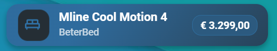

# Price Tracker Card

[](https://github.com/tschoehuijs/Price-Tracker-Card/actions/workflows/validate.yml)
[](https://github.com/tschoehuijs/Price-Tracker-Card/stargazers)
[](https://github.com/tschoehuijs/Price-Tracker-Card/releases)
[](LICENSE)

A custom dashboard card for Home Assistant that displays the lowest valid price from an ordered list of sensor entities.

[](https://my.home-assistant.io/redirect/hacs_repository/?owner=tschoehuijs&repository=Price-Tracker-Card&category=plugin)

## Preview



## Features

- Shows the lowest valid numeric price.
- Tracks one or multiple price sensors.
- Ignores unavailable, unknown, zero, negative and non-numeric values.
- Uses sensor order as the tie-break preference.
- Supports optional labels for product variants.
- Uses the icon of the selected sensor or a configured icon override.
- Includes a native Home Assistant visual editor.
- Includes a native multi-entity selector with reordering.
- Uses the native Home Assistant Layout tab for sizing.
- Supports theme-based two-colour gradients.
- Opens the more-info dialog for the selected sensor.
- Remains compatible with the earlier `variants` configuration format.

## Installation

### HACS

Use the button below to add the repository to HACS:

[](https://my.home-assistant.io/redirect/hacs_repository/?owner=tschoehuijs&repository=Price-Tracker-Card&category=plugin)

Alternatively:

1. Open HACS in Home Assistant.
2. Open the three-dot menu.
3. Select **Custom repositories**.
4. Enter:

   ```text
   https://github.com/tschoehuijs/Price-Tracker-Card
   ```

5. Select **Dashboard** as the category.
6. Select **Add**.
7. Search for **Price Tracker Card**.
8. Download the latest release.
9. Refresh the Home Assistant frontend.

### Manual installation

1. Download `price-tracker-card.js` from the latest release.
2. Copy the file to:

   ```text
   /config/www/price-tracker-card.js
   ```

   Depending on the file editor or add-on, the configuration directory may appear as:

   ```text
   /homeassistant/www/price-tracker-card.js
   ```

3. Open **Settings → Dashboards → Resources**.
4. Add the following resource:

   ```text
   /local/price-tracker-card.js
   ```

5. Select **JavaScript module** as the resource type.
6. Refresh the Home Assistant frontend.

## Configuration

Add the card through the Home Assistant card picker by searching for:

```text
Price Tracker Card
```

The visual editor provides fields for:

- Product name
- Icon
- Gradient start colour
- Gradient end colour
- Unavailable text
- Ordered price sensors
- Variant labels

The card dimensions are managed through Home Assistant's native **Layout** tab.

## Examples

### Example 1: one price sensor

Use this configuration when a product has only one tracked price.

```yaml
type: custom:price-tracker-card
name: M line Cool Motion 4
icon: mdi:bed-king-outline
accent: var(--accent-2-color)
accent_end: ""
unavailable_text: Price unavailable
entities:
  - sensor.mline_cool_motion_4
labels:
  - 180 × 210 cm
```

The card displays the value of `sensor.mline_cool_motion_4` and uses `180 × 210 cm` as the subtitle.

### Example 2: multiple product variants

Use multiple sensors when different colours, sizes or retailers each have their own price sensor.

```yaml
type: custom:price-tracker-card
name: Pebble Slide Pro
icon: mdi:car-child-seat
accent: var(--accent-5-color)
accent_end: ""
unavailable_text: Price unavailable
entities:
  - sensor.maxi_cosi_pebble_slide_pro_copper_terra_met_isofixbase_familyfix_slide_pro
  - sensor.maxi_cosi_pebble_slide_pro_oak_truffle_met_isofixbase_familyfix_slide_pro
  - sensor.maxi_cosi_pebble_slide_pro_sapphire_sand_met_isofixbase_familyfix_slide_pro
labels:
  - Copper Terra
  - Oak Truffle
  - Sapphire Sand
```

The card displays the lowest valid price and the corresponding colour.

The sensor order also defines the preference when prices are equal:

1. Copper Terra
2. Oak Truffle
3. Sapphire Sand

If all three sensors report the same lowest price, the card displays **Copper Terra**.

### Example 3: two-colour gradient

Set `accent_end` to create a gradient between two theme colours.

```yaml
type: custom:price-tracker-card
name: Coffee machine
icon: mdi:coffee-maker
accent: var(--accent-2-color)
accent_end: var(--accent-3-color)
unavailable_text: No price available
entities:
  - sensor.coffee_machine_store_one
  - sensor.coffee_machine_store_two
  - sensor.coffee_machine_store_three
labels:
  - Store one
  - Store two
  - Store three
```

The icon follows `accent`, while the right side of the background and price field follow `accent_end`.

### Example 4: automatic icon and friendly names

Both `icon` and `labels` are optional.

```yaml
type: custom:price-tracker-card
name: Smart thermostat
accent: var(--accent-4-color)
accent_end: ""
entities:
  - sensor.smart_thermostat_store_one
  - sensor.smart_thermostat_store_two
```

In this configuration:

- The icon is taken from the sensor with the selected lowest price.
- The sensor's friendly name is shown as the variant label.
- `mdi:tag-outline` is used if the selected sensor has no icon.

## Configuration options

### `name`

Product name displayed on the card.

```yaml
name: Pebble Slide Pro
```

### `icon`

Optional icon override.

```yaml
icon: mdi:car-child-seat
```

If omitted, the card uses the icon from the sensor with the selected lowest price.

If that sensor does not provide an icon, the card uses:

```text
mdi:tag-outline
```

### `accent`

Theme colour used for the left side of the background gradient and the icon.

```yaml
accent: var(--accent-5-color)
```

The visual editor provides a dropdown containing the supported theme colour variables.

### `accent_end`

Optional theme colour used for the right side of the gradient and the price field.

```yaml
accent_end: var(--accent-6-color)
```

If omitted or empty, the card reuses `accent`.

### `unavailable_text`

Text displayed when none of the configured sensors provides a valid price.

```yaml
unavailable_text: Price unavailable
```

### `entities`

Ordered list of price sensors.

```yaml
entities:
  - sensor.product_variant_one
  - sensor.product_variant_two
  - sensor.product_variant_three
```

The first sensor has the highest preference when prices are equal.

### `labels`

Optional display labels corresponding to the sensors in the same order.

```yaml
labels:
  - Variant one
  - Variant two
  - Variant three
```

If no label is provided, the entity's friendly name is used.

## Price handling

A sensor value is included only when it:

- Is numeric
- Is greater than zero
- Is not `unknown`
- Is not `unavailable`

The card displays the lowest remaining value using Dutch number formatting:

```text
€ 538,99
```

When multiple sensors have the same lowest value, the first matching sensor in `entities` is selected.

## Dashboard sizing

In a Sections dashboard, open the card editor and select the **Layout** tab to change the card dimensions.

The default size is:

```text
12 columns × 1 row
```

Rows and columns are deliberately not stored in the Price Tracker Card configuration because Home Assistant manages those settings through the native Layout tab.

## Updating

When installed through HACS:

1. Open HACS.
2. Open **Price Tracker Card**.
3. Install the available update.
4. Refresh the Home Assistant frontend.

When installed manually:

1. Replace `price-tracker-card.js`.
2. Refresh the Home Assistant frontend.
3. If the browser keeps the previous version cached, reload the page without cache.

## Troubleshooting

### Custom element does not exist

Confirm that the JavaScript resource is loaded and that only one version of the card is registered.

Do not load both:

```text
/local/price-tracker-card.js
```

and:

```text
/hacsfiles/Price-Tracker-Card/price-tracker-card.js
```

at the same time.

If the card was installed through HACS, go to **Settings → Dashboards → Resources** and remove the old manually added `/local/price-tracker-card.js` resource.

After changing resources, refresh the Home Assistant frontend without using the browser cache.

### The card does not update

Confirm that the configured sensor entities contain valid numeric states.

You can check the sensor values in Home Assistant under:

**Developer Tools → States**

Search for each configured entity and verify that the state contains a numeric price, for example:

```text
538.99
```

The following values are ignored:

- `unknown`
- `unavailable`
- `0`
- Negative values
- Non-numeric text

Also verify that every price sensor is included under `entities`:

```yaml
entities:
  - sensor.product_variant_one
  - sensor.product_variant_two
```

### The incorrect variant is selected

Check the sensor order. When prices are equal, the first matching sensor wins.

For example:

```yaml
entities:
  - sensor.product_copper
  - sensor.product_oak
  - sensor.product_sapphire
```

If all three sensors report the same lowest price, `sensor.product_copper` is selected.

Also verify that the order of `labels` matches the order of `entities`:

```yaml
entities:
  - sensor.product_copper
  - sensor.product_oak
  - sensor.product_sapphire

labels:
  - Copper Terra
  - Oak Truffle
  - Sapphire Sand
```

### A variant label is missing

Add one label per sensor in the same order:

```yaml
entities:
  - sensor.product_red
  - sensor.product_blue

labels:
  - Red
  - Blue
```

If fewer labels than entities are configured, the sensor's friendly name is used for the remaining entities.

### The icon is missing

Set an icon explicitly:

```yaml
icon: mdi:tag-outline
```

If `icon` is empty, the card tries to use the icon attribute of the sensor with the selected lowest price.

If the selected sensor has no icon, the card falls back to:

```text
mdi:tag-outline
```

### The card shows Price unavailable

Check each configured sensor under **Developer Tools → States**.

At least one configured sensor must have a numeric state greater than zero. Values such as `unknown`, `unavailable`, `0`, negative numbers, and text are ignored.

Also confirm that the entity IDs are spelled correctly and still exist in Home Assistant.

### The price is formatted incorrectly

The card expects a plain numeric sensor state, for example:

```text
538.99
```

The currency unit may be stored as the sensor's unit of measurement, but the state itself should not contain text such as:

```text
€538.99
```

If the source sensor includes a currency symbol or other text in its state, adjust the source sensor or its value template so that it returns only the numeric value.

### Changes are not visible after an update

Refresh the Home Assistant frontend without using the cached JavaScript:

- Desktop browser: press `Ctrl+F5`.
- Home Assistant app: fully close and reopen the app.
- Alternatively, open Home Assistant in a private browser window.

Also confirm that the previous manually installed resource is no longer loaded alongside the HACS version.

### The visual editor does not open

Confirm that the installed JavaScript version includes the native Home Assistant configuration form.

Then verify that the latest card release is installed through HACS and refresh the frontend without cache.

The card can still be configured manually in YAML if the visual editor is temporarily unavailable.

### The card is the wrong size

In a Sections dashboard, edit the card and open Home Assistant's native **Layout** tab.

Use the Layout tab to set the number of columns and rows. The card's default size is 12 columns by 1 row, but the selected dashboard layout can override that default.

Rows and columns are not configured in the Price Tracker Card's own settings.

### HACS installation does not appear to work

Confirm that the custom repository was added to HACS using the **Dashboard** category.

After downloading the card through HACS, verify that Home Assistant has a resource for the HACS-installed JavaScript file. Do not keep the older manual `/local/price-tracker-card.js` resource active at the same time.

Refresh the frontend after installation.


## Changelog

See CHANGELOG.md.

## Licence

Price Tracker Card is released under the LICENSE.
